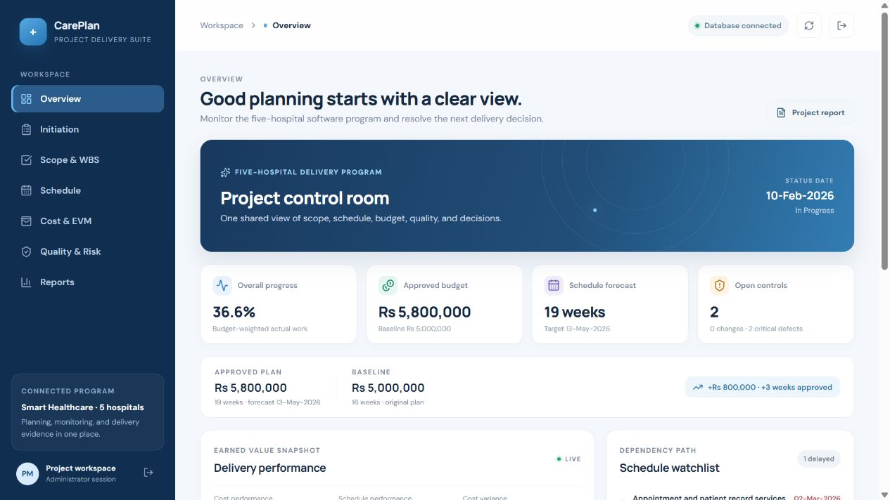

# CarePlan | Smart Healthcare Project Management System

A software project-management application for the five-hospital healthcare case study. It tracks planning and delivery work; it is not a patient-care or hospital-operations product. All included project records and UI captures are synthetic demonstration data.

**Public GitHub repository:** https://github.com/fa23-bse-015/careplan-healthcare-pms

## Two runnable clients

- `healthcare_pms/` — Windows Python desktop application with SQLite, six project-management areas, seed data, and unit tests.
- `healthcare_pms_web/` — responsive React 19 / Next.js app with server routes, SQLite-compatible local persistence, PWA manifest, and seven navigation views.
- `docs/screenshots/` — captures of the running desktop, desktop web and mobile web UI.

Each client has an independent local database; data is not synchronized between them.

## Dashboard preview

The responsive dashboard below uses synthetic project data. The web application also includes initiation, scope and WBS, schedule, cost and EVM, quality and risk, change control, and reporting views.



## Design diagrams and report

- [Application architecture](docs/architecture.png) — Python desktop and React web clients with their application layers and separate local databases.
- [Database ERD](docs/database_erd.png) — fourteen entities with primary keys, foreign keys, unique keys, and relationship legend.
- [Final Word report](docs/CarePlan_Final_Report.docx) — numbered chapters, table of contents, lists of tables and figures, interface screenshots, test scenarios, deployment guide, and references.

## React web app on Windows

Install Node.js 22+, open `healthcare_pms_web` in VS Code, then use its PowerShell terminal:

```powershell
npm install
npm run db:setup
npm run dev
```

Open `http://localhost:3000`. Create a private `.env.local` from `.env.example` and set `APP_ADMIN_PASSWORD` (at least 8 characters locally) and `SESSION_SECRET` (at least 32 characters) before starting. Never commit `.env.local`. Run `npm run typecheck` and `npm run build` to verify a build.

## Python desktop app

Install Python 3.10+ with Tkinter, open `healthcare_pms` in VS Code, and run:

```powershell
python app.py
```

The app creates the SQLite database and synthetic sample records when needed. Python unit tests run with `python -m unittest discover -s tests -v`.

## Case-study baseline

The original sample plan is PKR 5,000,000 over 16 weeks. A combined AI preliminary-diagnosis and mobile-application change adds PKR 800,000 and 15 working days once. Planning uses weekdays without a public-holiday calendar. No clinical diagnosis is performed.

## Vercel

For cloud operation, deploy `healthcare_pms_web` as the project root, attach a persistent Turso database, configure `TURSO_DATABASE_URL`, `TURSO_AUTH_TOKEN`, `APP_ADMIN_PASSWORD` (12+ characters), and `SESSION_SECRET` (32+ characters), then redeploy. Local SQLite storage is not persistent on Vercel. See the web README for the full checklist. Never use the local demo password in a public deployment.
